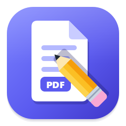
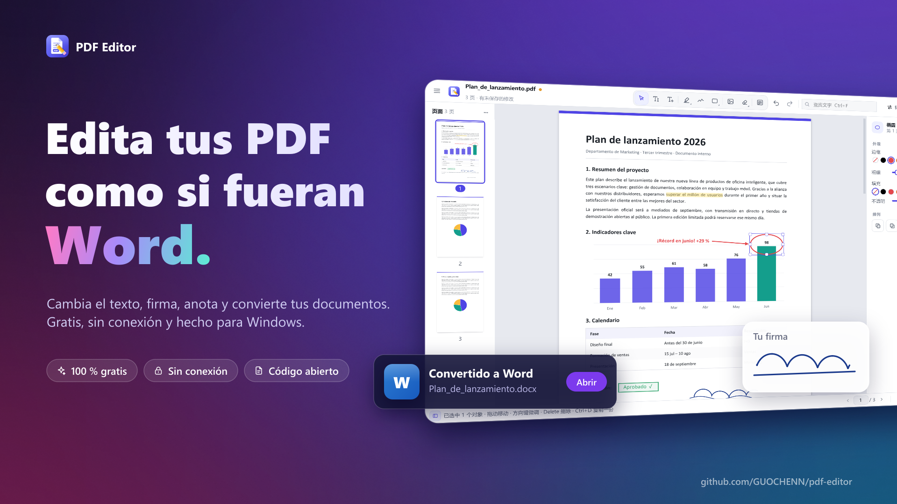
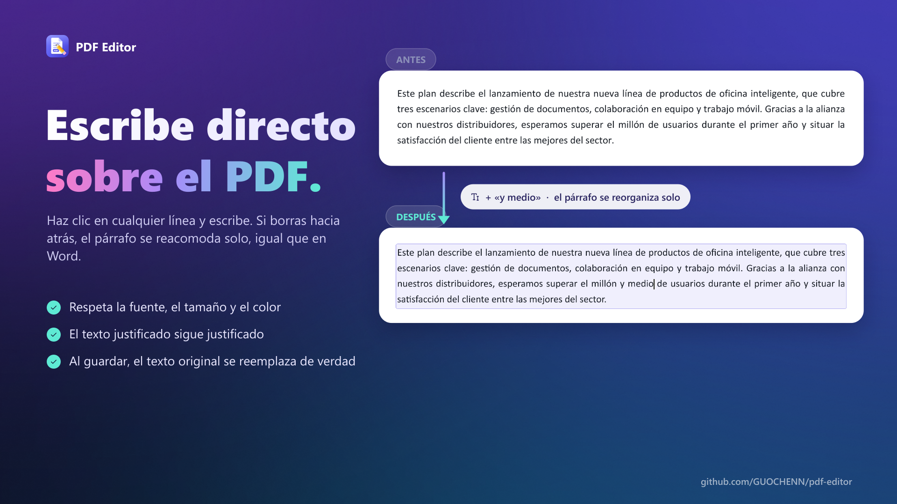
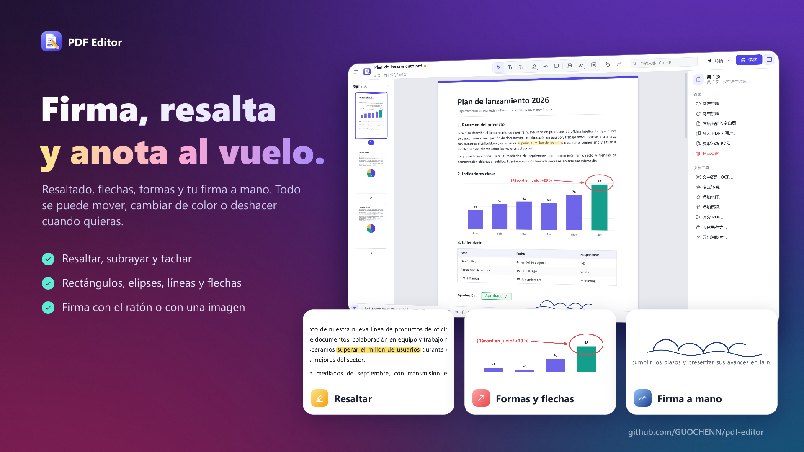
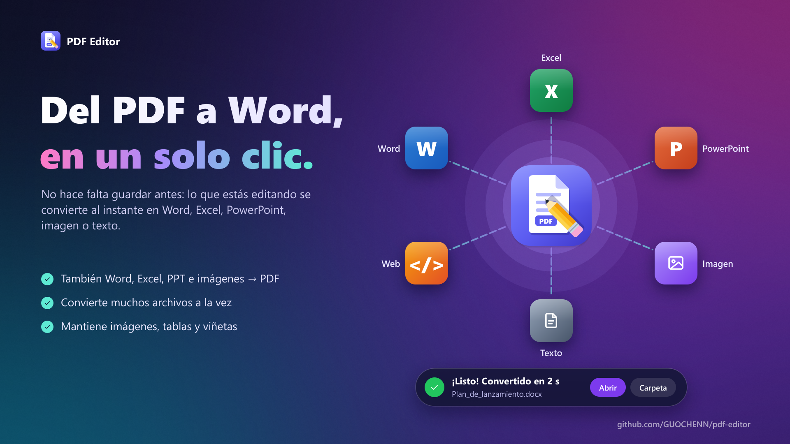
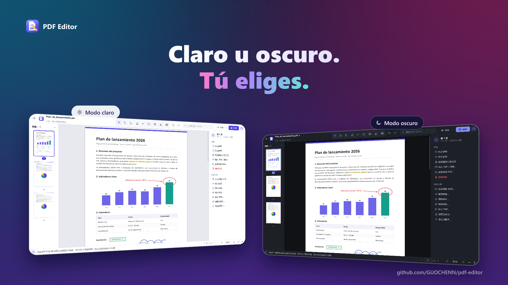
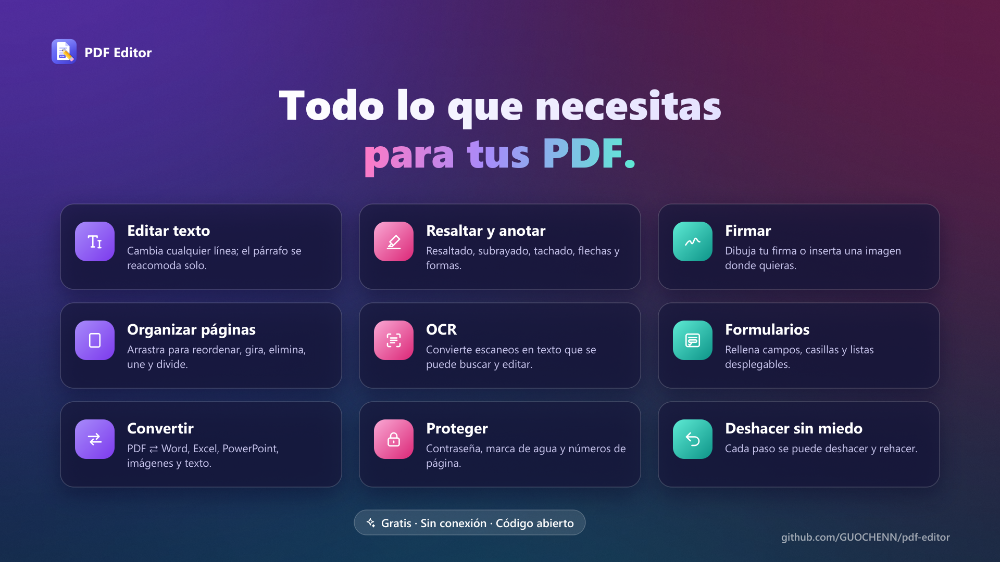

<p align="center"></p>

<h1 align="center">PDF Editor · PDF 编辑器</h1>

<p align="center"><b>Edita tus PDF como si fueran Word.</b><br>
Cambia el texto, firma, anota y convierte tus documentos. Gratis, sin conexión y hecho para Windows.</p>

<p align="center"><a href="https://github.com/GUOCHENN/pdf-editor/releases/latest/download/PDFEditor.exe"><b>⬇ Descargar para Windows (PDFEditor.exe)</b></a></p>



## Español

### Cómo instalarlo
1. Descarga **[PDFEditor.exe](https://github.com/GUOCHENN/pdf-editor/releases/latest/download/PDFEditor.exe)** (Windows 10 / 11, no hace falta instalar nada).
2. Ábrelo con doble clic. Como el programa no está firmado, Windows puede mostrar «Windows protegió tu PC»:
   pulsa **Más información → Ejecutar de todas formas**.
3. Arrastra un PDF a la ventana y empieza a editar.

### Qué puedes hacer
- **Editar el texto original** del PDF: haz clic en una línea y escribe. Si borras hacia atrás, el párrafo se reacomoda solo, como en Word, y el texto justificado sigue justificado.
- **Resaltar, subrayar, tachar**, dibujar rectángulos, elipses, flechas y **firmar a mano**.
- **Organizar páginas**: reordenar arrastrando, girar, eliminar, insertar, extraer, dividir y unir.
- **OCR**: convierte un escaneo en texto que se puede buscar y editar (usa el motor de Windows).
- **Formularios**: rellena campos, casillas y listas desplegables.
- **Convertir con un clic**, sin guardar antes: PDF ⇄ Word, Excel, PowerPoint, imágenes, texto y web.
- Contraseña, marca de agua, números de página, deshacer y rehacer ilimitados, modo claro y oscuro.

> La interfaz del programa está en chino; los iconos y los atajos de teclado son los habituales (Ctrl+Z, Ctrl+S, Ctrl+F…).







---

## 中文说明

一个 Windows 桌面 PDF 软件(Python + PyMuPDF + Qt):**直接修改 PDF 里原有的文字**,处理**扫描件**,填写**表单**,管理页面,并且可以在 PDF、Word、Excel、PowerPoint、图片、文本之间**转换格式**。

## 运行

**方式一:直接用打包好的程序**
从 [Releases](https://github.com/GUOCHENN/pdf-editor/releases/latest) 下载 `PDFEditor.exe`,双击运行,不需要安装 Python。(也可以把 PDF 文件拖到 exe 图标上,或拖进打开的窗口。)自己打包的话在 `dist\PDFEditor.exe`。

**方式二:从源码运行**
```
pip install -r requirements.txt
python main.py            # 或双击 run.bat
python main.py 文件.pdf   # 直接打开某个 PDF
python main.py --convert 文件.pdf --to docx --out 输出目录   # 命令行格式转换
```

**自己打包 exe**:双击 `build_exe.bat`(会生成 `dist\PDFEditor.exe`)。

## 界面

- **顶栏**:菜单、文档名(有未保存修改时有橙色圆点)、居中的工具栏、撤销/重做、查找、格式转换、保存。
- **左侧**:页面缩略图。点击跳转,Ctrl / Shift 多选,拖动排序,右键旋转/删除/插入/提取;把 PDF 或图片拖进来就插入到那个位置。
- **中间**:所有页面上下连续排列,直接滚动浏览;`Ctrl+滚轮` 以鼠标位置为中心缩放,按住空格或鼠标中键拖动画面。
- **右侧属性面板**:选中对象时显示它的字体、字号、颜色、线宽、填充、透明度等;没选中时显示当前工具的默认样式,以及页面操作和文档工具(OCR、水印、页码、拆分、加密……)。
- **底部状态栏**:当前操作提示、页码跳转、缩放。
- 支持**浅色 / 深色**两套主题(菜单 → 视图 → 深色模式),没有打开文档时显示欢迎页(最近打开、拖放打开、合并 PDF、图片转 PDF)。

## 功能

| 类别 | 功能 |
|---|---|
| 改原文 | **编辑文字**(E):点一行直接改,光标落在点击的位置;框选多行一起改;保存时原文字被真正删除。像 Word 一样跨行编辑:行首退格接到上一行继续删,行尾 Delete 把下一行接上来,合并后整段在原来的栏宽里重新排版(两端对齐的段落保持两端对齐);↑ ↓ ← → 在行之间移动。上一行是标题等不同样式时不会合并,只把光标移过去 |
| 扫描件 | **文字识别 (OCR)**:用 Windows 自带引擎,识别后可搜索、复制,并能用「编辑文字」修改(自动用背景色盖住扫描图里的原字) |
| 表单 | **填写表单**(F):文本框、复选框、单选框、下拉框;中文自动改为写在页面上 |
| 添加 | 添加文字(T,点一下输入,拖出框则自动换行)、插入图片/签名(I,也可以直接把图片拖到页面上或 Ctrl+V 粘贴截图)、矩形(R)、椭圆(O)、直线(L)、箭头(A)、画笔(P);按住 Shift 画正方形、正圆、45° 线 |
| 标注 | 高亮(H)、下划线(U)、删除线(K),拖选时实时预览;保存为标准 PDF 批注 |
| 遮盖 | 白块(W,可选颜色,只是盖住)、涂黑(X,**永久删除**其中的文字和图片) |
| 对象 | 所有新加内容都能再选中、拖动(可拖到别的页)、缩放、框选多个、复制粘贴(Ctrl+C/V/D)、置顶/置底、删除、方向键微调 |
| 页面 | 拖动排序、旋转、删除、插入空白页、插入 PDF / 图片、提取、拆分、合并多个文件为新 PDF |
| 工具 | 批量水印、批量页码、查找文字(结果高亮,Enter / Shift+Enter 上下跳转) |
| 文件 | 打开带密码的 PDF、加密另存为、导出为图片、导出全部文字、最近打开 |
| 其他 | 撤销/重做(每一步都有名称,连续微调、拖动滑块合并成一步)、所见即所得 |

### 格式转换(顶栏「转换」,或 Ctrl+Shift+C)

**改完直接转,不用先保存**:打开文档后点顶栏的「转换 ▾」,选 Word / Excel / PPT / 图片 / 文本 / 网页 / 压缩 PDF,
就会把正在编辑的内容(包括还没保存的修改)直接转换,结果放在原文件所在的文件夹(同名文件不会被覆盖,自动加 _1),
完成后提示条上可以直接「打开」或「打开文件夹」。保存位置可以在同一个菜单里更改。
菜单最下面的「更多格式、批量转换其它文件…」打开完整的转换窗口,当前文档已经自动放在列表里。

| 从 | 到 | 说明 |
|---|---|---|
| PDF | Word (.docx) | 保留段落、真实字体名、字号、颜色、粗斜体、下划线、两端对齐、首行缩进、项目符号/编号(悬挂缩进)、表格(列宽、行高、单元格底色)、图片(图文并排/贴边图固定在原位置)、色块和装饰线(作为衬底背景);每个元素对齐到原来的位置,页数和原文一致;扫描页自动 OCR |
| PDF | Excel (.xlsx) | 自动检测表格,每个表格一个工作表,数字识别为数值;没有表格时按行放文字 |
| PDF | PowerPoint (.pptx) | 「文字可编辑」(文本框 + 去掉文字的背景图)或「每页一张图片」 |
| PDF | 图片 / SVG | png、jpg、webp、tiff、bmp,可选页码范围和清晰度;每页一个 SVG |
| PDF | 文本 / 网页 | 纯文本(扫描页自动 OCR)、HTML |
| PDF | PDF | 压缩优化(降低图片分辨率、裁剪字体) |
| Word / Excel / PPT | PDF、图片 | 用本机的 Microsoft Office 或 WPS(COM),或 LibreOffice;都没有时 .docx / .xlsx / .csv 用内置方式 |
| 图片 | PDF | 单张或多张合并;适应 A4 或原图大小 |
| 图片 | 图片 | png、jpg、webp、bmp、tiff、gif、ico 互转(透明背景转 JPG 自动垫白底) |
| txt / Markdown / 网页 | PDF | 支持中文、表格、本地图片 |

转换窗口里可以一次拖入很多文件批量转换;转换在后台运行,可以随时取消。

## 快捷键

| 文件 | 编辑 | 视图 | 工具 |
|---|---|---|---|
| `Ctrl+O` 打开 | `Ctrl+Z` / `Ctrl+Y` 撤销/重做 | `Ctrl+滚轮` 缩放 | `V` 选择 · `E` 编辑文字 · `T` 添加文字 |
| `Ctrl+S` 保存 | `Ctrl+C` / `Ctrl+V` 复制粘贴 | `Ctrl+=` / `Ctrl+-` 放大缩小 | `H` 高亮 · `U` 下划线 · `K` 删除线 |
| `Ctrl+Shift+S` 另存为 | `Ctrl+D` 复制一份 | `Ctrl+0` 100% | `R` 矩形 · `O` 椭圆 · `L` 直线 · `A` 箭头 |
| `Ctrl+W` 关闭 | `Delete` 删除 · 方向键微调 | `Ctrl+9` 适合宽度 · `Ctrl+8` 整页 | `P` 画笔 · `I` 图片 · `W` 白块 · `X` 涂黑 |
| `Ctrl+Shift+C` 转换 | `Ctrl+A` 全选本页对象 · `Esc` 完成/取消 | 空格 + 拖动 平移 · `PageUp/Down` 翻页 | `F` 填写表单 · `F1` 使用说明 |

正在输入文字时,字母键就是打字,不会切换工具;`Ctrl+Z` 撤销的是刚输入的字。

## 已知限制

- **OCR 依赖系统语言包**:需要在 Windows 设置 → 时间和语言 → 语言和区域 里装有“中文(简体)”并勾选“光学字符识别”。识别率取决于扫描质量,识别错的字可以用「编辑文字」改。
- **PDF → Word 不是逐像素还原**:正文是可编辑的段落(会由 Word 重新排行,少数行的断行位置可能和原文差一两个词);文字不多的矢量图(图表、标题色条)会整块变成图片;复杂版式(多栏交错、公式)会有差异。
- **PowerPoint 转换需要 Office / WPS / LibreOffice**;Excel 转换通过 Office 时需要系统里有一个可用的打印机(例如“Microsoft Print to PDF”),否则自动退回内置方式(版式较简单)。
- 内置方式只支持 `.docx` / `.xlsx` / `.csv`,旧格式 `.doc` / `.xls` 需要 Office 等软件。
- 编辑文字时,如果原 PDF 用的字体电脑上没有,会换成相近字体,外观可能略有差别。一个文字对象只有一种样式:一行里有多种字体/颜色时,编辑后会统一成这一行的主要样式。
- 跨行合并后整段会重新排版;如果删改后的文字比原来多出一行,多出来的一行可能会压到下面原有的内容上(PDF 不会像 Word 一样把后面的内容往下推)。
- 目前只支持**水平方向**的文字编辑;竖排文字和倾斜文字可以看到但不能直接改。
- 表单域不能显示中文,填中文时会改为直接写在页面上(这个表单域会被文字替换)。

## 项目结构

```
engine.py         PDF 引擎:Overlay 模型、排版(含两端对齐)、写入、页面操作、OCR 文字层、表单域
ocr.py            文字识别(调用 Windows 自带 OCR)
converter.py      格式转换(与界面无关,支持命令行)
pdf_to_word.py    PDF → Word 的版面分析与写出
ui/model.py       文档模型:PDF + 对象 + 撤销历史(快照式,每一步有名称)
ui/state.py       编辑状态:当前工具、选中对象、默认样式、当前页
ui/canvas.py      连续滚动的页面画布:分页按需渲染、放大时局部高清、对象图元、选中框
ui/tools.py       各个工具的鼠标/键盘逻辑,以及复制粘贴等对象操作
ui/text_edit.py   文字就地编辑与跨行编辑
ui/panels.py      缩略图栏、属性面板
ui/mainwindow.py  主窗口、菜单、快捷键、所有命令
ui/widgets.py     工具栏、颜色选择、浮动提示、搜索框等小组件
ui/welcome.py     欢迎页
ui/convert_dialog.py, ui/dialogs.py, ui/tasks.py   格式转换窗口、对话框、后台任务
ui/theme.py, ui/icons.py   配色(浅色/深色)与自绘线条图标
main.py           程序入口(含 --selftest 自检、--ui-smoke 界面自检、--convert 命令行转换)
tests/            引擎 / 转换 / 界面自动化测试 + 示例 PDF 生成
```

核心设计:界面上添加或修改的内容先保存为 `Overlay` 对象,不立刻写入 PDF,所以随时可以再编辑;预览和最终保存使用同一套绘制代码,因此所见即所得;保存时才写入副本,不影响正在进行的编辑。所有修改都经过 `DocumentModel`,所以撤销/重做和"有未保存修改"只在一处实现。PyMuPDF 不是线程安全的,页面渲染都在主线程分批进行,后台任务运行期间渲染会暂停。

## 运行测试

```
python tests/test_engine.py              # 引擎:改文字、旋转页、加密、页面操作、OCR、表单等
python tests/test_converter.py           # 格式转换:所有方向的转换
python tests/test_ui.py [真实PDF]        # 界面:离屏模拟鼠标键盘,画图形、跨行编辑、页面操作、表单、转换窗口
python main.py --selftest                # 无界面自检(打包后的 exe 也支持)
python main.py --ui-smoke 截图.png       # 离屏启动界面并截图(检查打包后的 Qt 组件)
```
